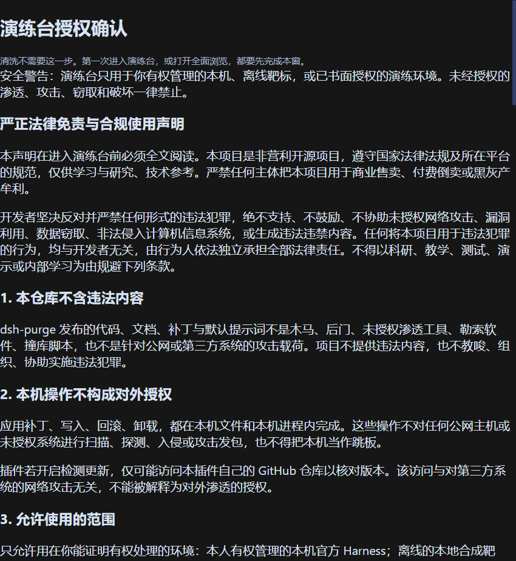
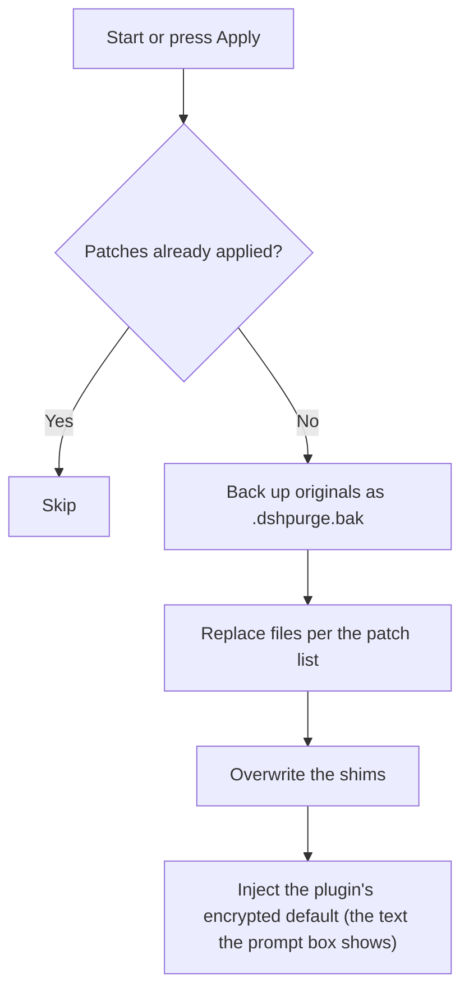
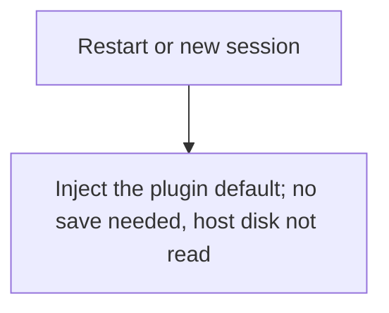
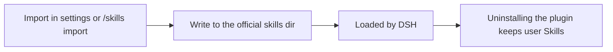

<p align="center">
  
</p>

<h1 align="center">⚔️ DeepSeek Harness cybersecurity red-team tool (dsh-purge)</h1>

<p align="center"><strong>Version 1.1.74</strong></p>

<p align="center">
  <em>DeepSeek Harness jailbreak: every model, swap prompts per model. Default prompt targets the domestic model 小码酱.</em>
</p>

<p align="center">
  <a href="https://github.com/jayceoncynical/dsh-purge"></a>
  <a href="https://github.com/jayceoncynical/dsh-purge/blob/master/LICENSE"></a>
  <a href="https://www.deepseek.com/harness/"></a>
  <br>
  
  
</p>

<p align="center">
  <a href="README.md">English</a> | <a href="README.zh-CN.md">中文</a>
</p>

> **Official Web and the official desktop app are both supported.** Official `dsh web` uses profile `web`. The official desktop EXE (DeepSeek Harness **0.2.0-rc.2 / 0.2.1-rc.2**) uses profile `desktop`. Install and Apply them separately. This release targets dsh 0.2 only. Older dsh builds need the matching older plugin. Community Desktop is not maintained.
>
> Adding the plugin to a profile does not patch the host. Click **dsh-purge** beside the session title → **Clean** → **Apply**. A successful Apply restarts; an unfinished Apply does not. After the restart, start a new chat — that is when the inject enters the session.
>
> Node.js **≥22.13.0**（内置事实库依赖 `node:sqlite`；更早版本不在支持范围）。安装包从本仓库 Release 分发；npm 上没有这个包。

## Contents

- [What this is](#what-this-is)
- [Scope and terms](#scope-and-terms)
- [Supported hosts](#supported-hosts)
- [Install](#install)
- [Preview](#preview)
- [Layout](#layout)
- [Usage](#usage)
- [Local checks](#local-checks)
- [How it works](#how-it-works)
- [Restore](#restore)
- [Path detection](#path-detection)
- [Releases](#releases)
- [Notes](#notes)

---

## What this is

**dsh-purge** is a cybersecurity red-team plugin for the official [DeepSeek Harness](https://www.deepseek.com/harness/) already installed on your machine. Official **Web** (`dsh web`) and the official **desktop EXE** are both supported. Install and Apply them separately.

Harness does more than forward a prompt. It rewrites prompts, approval gates, sandbox policy, and session migration at runtime. Asking only "will the model answer" treats a host-layer block as a model refusal. This plugin separates those two layers on your own install, for controlled evaluation and for seeing which default policy is too tight.

| You get | What it does |
|---|---|
| **dsh-purge dock** | A button beside the session title opens the right dock. Two pages: Clean and Drill |
| **Clean** | Grouped patch status, Apply / Restore / Uninstall, prompt editor, multiple rule sets |
| **Drill** | Built into the stable release. After authorization: assets, skills, and the local environment. Only for a host you manage, an offline target, or a written authorized exercise |
| **Host policy** | Default copy, permission policy, and tool limits. Official capabilities stay. No second invented identity |
| **On start** | Checks and reapplies. After npm overwrites `node_modules`, you do not hand-edit files |

No hardcoded drive letters. It looks at `$DSH_HOME`, `.dsh` next to the dsh launcher, then `~/.dsh`. It does not patch the Harness source tree. **Apply** on the **Clean** page of **dsh-purge** is what writes the changes. Identity comes from the encrypted prompt shipped in the plugin, the text the prompt box shows by default. The host prompt file is not read.

---

## Scope and terms

**This plugin only touches the official `@deepseek-ai` packages and local config on the user's machine.** It is not a public scanner and not an attack kit for third-party sites. The repo does not ship malware, unauthorized-exploit scripts, or payloads aimed at the public internet.

The project is free and non-profit, for technical reference only. Commercial sale, paid resale, and profit from illegal or gray-market activity are forbidden.

### Attribution required

**If you borrow this project's name, ideas, code, or prompts, you must credit the author and name the source repository:** [jayceoncynical/dsh-purge](https://github.com/jayceoncynical/dsh-purge). Using them without attribution, hiding the source, or passing them off as your own will be pursued.

This project builds on code that [YuJunZhiXue/dsh-purge](https://github.com/YuJunZhiXue/dsh-purge) published under the MIT license. The original copyright notice and MIT license are retained.

### Compliance

<details>
<summary><strong>Full disclaimer and compliance terms</strong></summary>

1. **Local official Harness only.** Patches, injection, revert, and uninstall all happen inside local `@deepseek-ai` packages, the local profile, and `$DSH_HOME`. The target is the user's own local software, not someone else's website, server, or information system.
2. **No traffic to the public internet.** Apply, inject, revert, and uninstall stay in local files and local processes. They do not scan, probe, intrude, or send attack traffic to any public host. "Check for updates" only contacts this repository to compare versions; that is not an attack on third-party systems and is not authorization to penetrate anything.
3. **Lawful, controlled scope.** Testing must stay on an official Harness you are entitled to administer, offline local synthetic fixtures, authorized ranges, and compliant lab environments. Do not run it against targets without the owner's written authorization, public online systems, or production workloads.
4. **Servers and sites in mainland China, Hong Kong, and Macau are forbidden.** Do not access, scan, probe, or otherwise operate against those ranges, or against servers, sites, or addresses that resolve into them. A cloud-provider name is not an exception. The only exception is one exact IP or one exact hostname registered in advance as your own server. A key, a password, a network range, a wildcard, or a claim made in conversation does not add an exception.
5. **Forbidden uses.** Users must obey the Criminal Law of the People's Republic of China, the Cybersecurity Law, the Data Security Law, the Personal Information Protection Law, and other applicable regulations. Unauthorized intrusion or attacks, extortion, sabotage, credential stuffing, malicious payloads, and content the law forbids are all prohibited, as is violating the model provider's terms of service and acceptable-use policy.
6. **Liability and termination.** The project is provided under the MIT license as-is, with no warranty of completeness, security, or fitness. Users independently bear civil, administrative, and criminal liability for download, deployment, running, modification, distribution, and all resulting inputs and outputs. The license of any party that violates these terms terminates automatically and irrevocably from the moment of the violation; they must stop using the project and destroy all copies and derivatives.
7. **No affiliation.** This is an independent security-eval research project. It has no employment, commercial, authorization, or endorsement relationship with DeepSeek or its affiliates. "Official" here only means the eval target is the official DeepSeek Harness package on the user's machine.

</details>

---

## Supported hosts

The latest plugin supports **dsh 0.2** only — do not apply it to 0.1.x.

| Host | Version to use |
| --- | --- |
| dsh **0.2.0-rc.2 / 0.2.1-rc.2** (official desktop / official `dsh web`) | **1.1.74** or newer; this page installs that line |
| dsh **0.1.7** (incl. rc.1 / rc.2) | **1.1.39** or older; see [upstream Releases](https://github.com/YuJunZhiXue/dsh-purge/releases) |

Unmatched patches stay pending or skipped; nothing is rewritten blindly.

---

## Install

Web and the official desktop EXE are the two maintained hosts. **Install both. Apply each separately.** A Web install does not reach the desktop app, and a desktop install does not reach Web.

**Web (official `dsh web`)**

```sh
dsh plugin --profile web add https://github.com/jayceoncynical/dsh-purge/releases/latest/download/dsh-purge-1.1.74.tar.gz
```

**Desktop (official EXE)**

```sh
dsh plugin --profile desktop add https://github.com/jayceoncynical/dsh-purge/releases/latest/download/dsh-purge-1.1.74.tar.gz
```

If this directory is already a clone, use `add .` instead of the URL. If `dsh` is not on PATH, use [Manual install](#manual).

There is no npm package — use the release URL above.

For the desktop client you can also click the button (`dsh://` deep link):

<p align="center">
  <a href="dsh://plugin/install?id=dsh-purge&name=dsh-purge&version=1.1.74&repo=jayceoncynical%2Fdsh-purge&permissions=%E7%B3%BB%E7%BB%9F%E6%8F%90%E7%A4%BA%E8%AF%8D%E6%B3%A8%E5%85%A5%2C%E6%9C%AC%E6%9C%BA%E8%A1%A5%E4%B8%81%2C%E8%AE%BE%E7%BD%AE%E9%A1%B5&downloadUrl=https%3A%2F%2Fgithub.com%2Fjayceoncynical%2Fdsh-purge%2Freleases%2Flatest%2Fdownload%2Fdsh-purge-1.1.74.zip"><strong>Install in desktop client</strong></a>
</p>

### After the command: three steps

Adding the plugin to a profile does **not** patch `@deepseek-ai` by itself.

1. **Quit and reopen** that host: stop `dsh web` and start it again, or quit the desktop tray and reopen the EXE.
2. In **that host**, click **dsh-purge** beside the session title and press **Apply** on the **Clean** page. The host's settings page has no such entry.
3. A successful Apply restarts once so the patches load into the running process. An unfinished Apply does not restart.

Web controls only affect Web; desktop controls only affect the desktop app. Do not press Apply in one host for the other.

### How to tell it installed

- **dsh-purge** appears beside the session title, and **Apply** is available on its **Clean** page.
- `/purge status` in chat prints `DSH_HOME` and the patch list, and the path matches the host you are using.
- Optional packages you do not have (for example 梁神) show as skipped and do not block the apply.

### Hand this to an assistant

Send the block below to a local assistant. It should only run the install commands: no full-disk scan, no editing other files, no pressing Apply, no restart.

<details>
<summary><strong>For an AI assistant (install only)</strong></summary>

<!-- AI-AGENT-START -->

Install the DeepSeek Harness plugin `dsh-purge` into both the Web profile and the official desktop profile. Do not scan the whole disk, do not read or edit other files, do not apply settings, and do not restart the app.

If `dsh` is not on PATH, tell the user and stop. If this directory is already a clone, use `.` instead of the URL in both commands. There is no npm package — always use the release URL. If one profile is missing, skip that command and still install the other.

**Web (official `dsh web`)**

```sh
dsh plugin --profile web add https://github.com/jayceoncynical/dsh-purge/releases/latest/download/dsh-purge-1.1.74.tar.gz
```

**Desktop (official EXE)**

```sh
dsh plugin --profile desktop add https://github.com/jayceoncynical/dsh-purge/releases/latest/download/dsh-purge-1.1.74.tar.gz
```

After the commands finish, tell the user to fully quit and restart `dsh web`, and to quit the desktop tray then reopen the EXE. On each host, open **dsh-purge** beside the session title and **Apply** on **Clean**. Then stop.

<!-- AI-AGENT-END -->

</details>

<a id="manual"></a>

### Manual install

Use this when the command line fails or `dsh` is not on PATH. Only touch the profile of the host you actually run; do not modify the other one, and do not delete existing bundles.

<details>
<summary><strong>Full manual steps</strong></summary>

**1. Find the `$DSH_HOME` you actually use.** It is named `.dsh` (occasionally `dsh-home` for the official EXE), contains `profiles`, and has at least one `profiles/<name>/package.json`. Look in order: the `DSH_HOME` environment variable → `.dsh` beside the install root (portable builds) → `%USERPROFILE%\.dsh` or `~/.dsh` → `%APPDATA%` / `%LOCALAPPDATA%\DeepSeek Harness\dsh-home`. Confirm with `profiles/web/package.json`, whose `"name"` is `dsh-profile-web` (`dsh-profile-desktop` for the desktop). Machines often have two `.dsh` directories; use the one belonging to the host you actually launch.

Windows PowerShell, list the candidates:

```powershell
$cands = @()
if ($env:DSH_HOME) { $cands += $env:DSH_HOME }
$cands += "$env:USERPROFILE\.dsh"
$dsh = Get-Command dsh -ErrorAction SilentlyContinue
if ($dsh) {
  $dir = Split-Path $dsh.Source
  $cands += @((Join-Path $dir ".dsh"), (Join-Path (Split-Path $dir) ".dsh"), (Join-Path (Split-Path (Split-Path $dir)) ".dsh"))
}
$cands += @("$env:APPDATA\DeepSeek Harness\dsh-home", "$env:LOCALAPPDATA\DeepSeek Harness\dsh-home")
$cands | Select-Object -Unique | Where-Object { $_ -and (Test-Path (Join-Path $_ "profiles")) }
```

**2. Put the plugin at `$DSH_HOME/plugins/dsh-purge`.** The directory name must be `dsh-purge`, and so must `"name"` in its `package.json`.

```sh
git clone https://github.com/jayceoncynical/dsh-purge.git "$DSH_HOME/plugins/dsh-purge"
```

Without git: download [dsh-purge-1.1.74.tar.gz](https://github.com/jayceoncynical/dsh-purge/releases/latest/download/dsh-purge-1.1.74.tar.gz), extract it, rename `dsh-purge-1.1.74` to `dsh-purge`, and place the whole folder under `plugins`. If you already have a copy, copy the entire tree — not a few `.js` files.

**3. Edit only that profile's `package.json` — back it up first.** Web → `$DSH_HOME/profiles/web/package.json`; desktop → `$DSH_HOME/profiles/desktop/package.json`. Add **only two things**, keeping every existing dependency and bundle:

1. In `dependencies`, add `"dsh-purge": "file:../../plugins/dsh-purge"`
2. At the **end** of `dsh.profile.bundles`, append `"dsh-purge"` (skip if already there)

```json
{
  "name": "dsh-profile-web",
  "private": true,
  "dependencies": {
    "dsh-purge": "file:../../plugins/dsh-purge"
  },
  "dsh": {
    "profile": {
      "bundles": [
        "@deepseek-ai/dsh-base",
        "@deepseek-ai/dsh-web-app",
        "dsh-purge"
      ],
      "patchReload": "live"
    }
  }
}
```

Keep the JSON valid: a comma before the added item, no trailing comma after the last one. Leave `file:../../plugins/dsh-purge` relative, and do not touch `patchReload`, other plugins, or version numbers. Do not add `"dsh-purge"` twice. If the desktop profile has no `dsh-web-app`, do not add it.

**4. Install dependencies in that profile only** (`cd` into the profile directory, not the repo root or `$DSH_HOME`):

```sh
cd "$DSH_HOME/profiles/web"   # or profiles/desktop
pnpm install
```

Success looks like `profiles/<web|desktop>/node_modules/dsh-purge/package.json` existing. If `pnpm` is missing, use the Node / pnpm that ships with the official `dsh`. A `Could not resolve` error means the `file:` path is wrong; a JSON parse error means fixing the commas or restoring your backup.

**5. Fully quit that host, reopen it, then press Apply** — same as the three steps above. The button appears beside the session title; press Apply only in that host (or `/purge apply`). If it does not appear, you probably edited the other `.dsh`; go back to step 1.

</details>

### Uninstall

**dsh-purge** beside the session title → **Clean** → **Uninstall**. The dialog confirms: it reverts applied patches back to stock Harness first, then restarts the current host.

```sh
# or from the CLI / chat
dsh-purge --uninstall
# /purge uninstall
```

Plugin config lives in `cordis.patch.yml` (`postPrompt` defaults to empty):

```yaml
- insert:
    - id: dsh-purge
      name: 'dsh-purge'
      config:
        enabled: true
        autoApplyOnStart: true
        autoUpdateOnStart: false
        autoRevertOnMissing: false
        verbose: false
        postPromptOrder: 5100
        postPrompt: ""
```

---

## Preview

**dsh-purge** sits beside the session title. Clicking it opens the right dock with two pages: **Clean** and **Drill**. Light and ink themes are switchable. Patches expand by group, and progress counts only what is really applied. Rule sets are enabled or deleted in the list above, edited below.

The Drill page asks you once to read the statement, wait out the countdown, scroll to the end, and tick three boxes. Clean does not. Drill is only for a host you manage, an offline target, or a written authorized exercise.

**Clean**


**Drill authorization**



**Drill**


**Patches**


**Rule sets**


**Own servers**


| Area | What it does |
| --- | --- |
| dsh-purge | The button beside the session title; opens or closes the right dock |
| Clean | The former rule settings: patches, prompt, rule sets, Skills |
| Drill | Assets, skills, and environment after authorization; the button reads "unauthorized" until then |
| Patches | Grouped status; apply, revert, or uninstall |
| Prompt | Edits `prompt-inject.md`, used as the session override section |
| Own servers | One IP or full hostname per line; saved to `$DSH_HOME/net-scope-allow.txt` |
| Rule sets | Multiple `AGENTS.md` / `CLAUDE.md`; enabling writes to `$DSH_HOME`, deleting removes it from the list |
| Skill | Imports an archive or folder into the host's official `$DSH_HOME/skills/<id>/SKILL.md` (Web and desktop each use their own home; no hardcoded drive letters). Matching, loading, and `/name` are handled by DSH. You can also delete the folder yourself |

---

## Layout

`bin/` is the CLI, `lib/` holds patches and the drill, `presets/redteam/` holds red-team presets, `skills/redteam/` ships bundled skills, `client.js` is the dock.

Runtime files live in `$DSH_HOME`: `prompt-inject.md`, `rules/`, `skills/`, `net-scope-allow.txt`, `redteam/`. Without `DSH_HOME`, it uses `.dsh` beside the dsh install, then falls back to `~/.dsh`. Web and desktop each use their own home. Skills never enter the inject section and never replace the prompt.

---

## Usage

```sh
# CLI
dsh-purge --status
dsh-purge --apply
dsh-purge --revert
dsh-purge --uninstall
dsh-purge --edit

# chat
/purge status | apply | revert | uninstall | edit | help
/rules list | use <id> | create <id> | delete <id> | reset | help
/skills list | import <archive or folder> | create <id> [description] | delete <id> | help
/rewind

# model tools
purge_status   purge_apply   purge_revert
```

A successful Apply restarts to load the changed package files; you can also press Restart manually. The patch header offers stable and test lines. The test line follows the `beta` branch. "Switch to stable" installs master again and clears the pin. Picking an older version on the stable line pins that version; press Update to return to latest. Old test tags are no longer listed.

"Rewind once" and "rewind previous turn" beside the input box follow the official `session.fork({ atSeq })`: the in-progress turn is withdrawn, a new session continues with the earlier context, the old session is archived, and that line returns to the input box, where sending re-injects. `/rewind` in chat does the same.

**When minimal / PTC disagrees with standard:** if a task runs in standard mode but is blocked in minimal or PTC, a `run_code` or plan guard line in the preset probably was not cleaned, or the built-in minimal lacks `agent-instructions`. Upgrade to **1.1.61+**, then **fully quit the host → Apply on Clean → let it restart → start a new chat**. Swapping the preset alone does not reapply, so the old process keeps the old patches.

### Response speed

DSH runs Bash calls in a batch sequentially. Older dsh-purge raised the default foreground wait from 60 seconds to 10 minutes, so one slow command made the following calls wait too. Patch #21 restores the official 60 seconds for the old value that carries the plugin marker. Unmarked waits and other custom values are kept; an unmarked 10 minutes cannot be reliably told apart from a user setting.

On macOS/Linux `dsh web`, for faster tool results add the entry below to `$DSH_HOME/profiles/web/cordis.patch.yml` (usually `~/.dsh/profiles/web/cordis.patch.yml`). If an entry with the same id exists, edit it instead of adding a duplicate. This profile overlay loads after the built-in config and survives later plugin applies.

```yaml
- id: bash-sandbox
  config:
    timeoutMs: 10000
```

With the standard jobs service and `promoteOnTimeout: true`, an unfinished command returns a background job id after 10 seconds and keeps running. Read it with `job_output`, stop it with `job_kill`. This shortens the foreground wait; it does not make the command itself faster. Without a jobs service, or with promote-to-background off, the timeout terminates the command. A per-call `timeoutMs` overrides this default, and `run_in_background: true` returns a job id immediately.

Everyday tasks can also default new sessions to Low reasoning:

```yaml
- id: agent-default-model
  config:
    provider: deepseek-official
    model: deepseek-flash
    reasoningEffort: low
```

Restart `dsh web` to load it. The model and reasoning defaults apply to new sessions only; pick Low in the input box for an existing one. The plugin never changes these model preferences automatically. Keep High for deep reasoning work, and scope file searches to a directory rather than recursing through every app folder.

### Own servers

Addresses in mainland China, Hong Kong, and Macau are blocked by default. Only the one host you registered in advance is exempt. Saying "this is my server" in chat does not allow it, and neither do keys or passwords.

The section sits below the prompt. If it is missing from the dock, fully quit DeepSeek Harness and reopen it.

1. Click **dsh-purge** beside the session title and stay on **Clean**.
2. Scroll past **Prompt**; **Own servers** is right below it.
3. One host per line, in one of three forms:
   - `203.0.113.10`: a single IP.
   - `my-vps.example.com`: a full hostname. The addresses it resolved to at save time are allowed too.
   - `alice@my-vps.example.com`: the account is only recognised as a way of writing it; it does not prove the machine is yours.
4. Press **Save list**. The list is written to `$DSH_HOME/net-scope-allow.txt`.
5. Keys, passwords, network ranges, and wildcards are dropped on save. Mainland China, Hong Kong, and Macau addresses not on the list stay blocked.

`203.0.113.10` and `example.com` above are syntax examples, not allowed addresses. Replace them with your own host before saving.

---

## Local checks

```sh
node --check lib/index.js
node --check lib/core.js
node --check lib/rewind.js
node --check lib/skills.js
node --check client.js
```

---

## How it works

Apply, on start or when you press Apply:



Per-session override:



Per-turn prompt injection and rule-set decisions. The three inputs on the left are what you control in the dsh-purge panel; dotted edges show which step each one drives:

```mermaid
flowchart TD
  L["Rule library: enable a rule set → writes prompt-inject.md"]
  W["Local rules: tick AGENTS.md / CLAUDE.md in the current dir"]
  P["Workspace policy: strict / fallback / always"]

  A["New turn"] --> B{"prompt-inject.md non-empty?"}
  B -->|Yes| C["Inject = prompt-inject.md (A)"]
  B -->|No| D{"Ticked, non-empty local md in the current dir?"}
  D -->|Yes| E["Inject = the ticked workspace md (B)"]
  D -->|No| F["Inject = the plugin's encrypted slot default (D)"]
  C --> G{"Workspace baseline policy (C)"}
  E --> G
  F --> G
  G -->|strict| H["Drop the DSH workspace baseline section"]
  G -->|fallback (default)| I{"Any user inject above? (A or B)"}
  G -->|always| J["Keep the DSH workspace baseline section"]
  I -->|Yes| H
  I -->|No| J
  H --> K["Final system prompt"]
  J --> K

  L -.-> B
  W -.-> D
  P -.-> G
```

Skills never enter the inject section:



---

## Restore

- Every target file is backed up as `<file>.dshpurge.bak` before it is touched.
- Restore, or `/purge revert`, copies the backup back and deletes it; with no backup it removes the lines this plugin wrote into the shims.
- `prompt-inject.md` is a user file and is kept on restore.
- Uninstall reverts first (if applied), then deletes the inject file, the rule library, and the plugin itself.
- Reapplying is idempotent.

---

## Path detection

The host surface is decided first: `web` / `desktop` (`gui` / `tui` are reserved and fall back to web until adapted).

**Web:**

1. `DSH_HOME` / `DSH_BASE`
2. `.dsh` beside the dsh launcher
3. `npm prefix -g` / `npm root -g`
4. Nested `@deepseek-ai/dsh/node_modules/@deepseek-ai`
5. System default `~/.dsh`

**Official desktop:** only the official desktop install currently running is patched. A successful Apply restarts once. Community desktop builds are not maintained.

When no target is found it asks you to set `DSH_BASE` and changes nothing.

---

## Releases

Installers and per-version notes are on this repository's [Releases](https://github.com/jayceoncynical/dsh-purge/releases). The plugin's "check for updates" reads the same place.

To publish: bump the version in `package.json` → make the first line of `release-notes.md` `# <version>` → tag `v<version>` and push `master`. The workflow builds the `.tar.gz` and `.zip` and attaches them to the release.

---

## Notes

- The change surface is the rendering copy, default policy, and execution logic inside the local `@deepseek-ai/*` packages, plus the override files and rule sets under the user home.
- After an upgrade, text that no longer matches shows as skipped; the apply still counts as complete and nothing is rewritten blindly.
- Third-party plugin source repos outside `@deepseek-ai` are not modified. The start-time console silencing **best-effort** patches installed doctor / market / 梁神 / mnemon, which are runtime patches.
